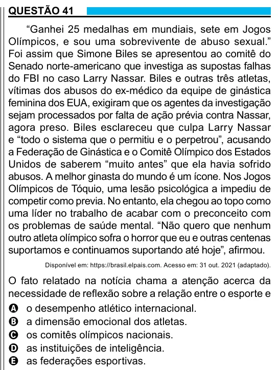

Texto extraído (pode conter ruído)

QUESTÃO 41  
“Ganhei 25 medalhas em mundiais, sete em Jogos  
Olímpicos, e sou uma sobrevivente de abuso sexual.”  
Foi assim que Simone Biles se apresentou ao comitê do  
Senado norte-americano que investiga as supostas falhas  
do FBI no caso Larry Nassar. Biles e outras três atletas,  
vítimas dos abusos do ex-médico da equipe de ginástica  
feminina dos EUA, exigiram que os agentes da investigação  
sejam processados por falta de ação prévia contra Nassar,  
agora preso. Biles esclareceu que culpa Larry Nassar  
e “todo o sistema que o permitiu e o perpetrou”, acusando  
a Federação de Ginástica e o Comitê Olímpico dos Estados  
Unidos de saberem “muito antes” que ela havia sofrido  
abusos. A melhor ginasta do mundo é um ícone. Nos Jogos  
Olímpicos de Tóquio, uma lesão psicológica a impediu de  
competir como previa. No entanto, ela chegou ao topo como  
uma líder no trabalho de acabar com o preconceito com  
os problemas de saúde mental. “Não quero que nenhum  
outro atleta olímpico sofra o horror que eu e outras centenas  
suportamos e continuamos suportando até hoje”, afirmou.  
Disponível em: https://brasil.elpais.com. Acesso em: 31 out. 2021 (adaptado).  
O fato relatado na notícia chama a atenção acerca da  
necessidade de reflexão sobre a relação entre o esporte e  
A o desempenho atlético internacional.  
B a dimensão emocional dos atletas.  
C os comitês olímpicos nacionais.  
D as instituições de inteligência.  
E as federações esportivas.

