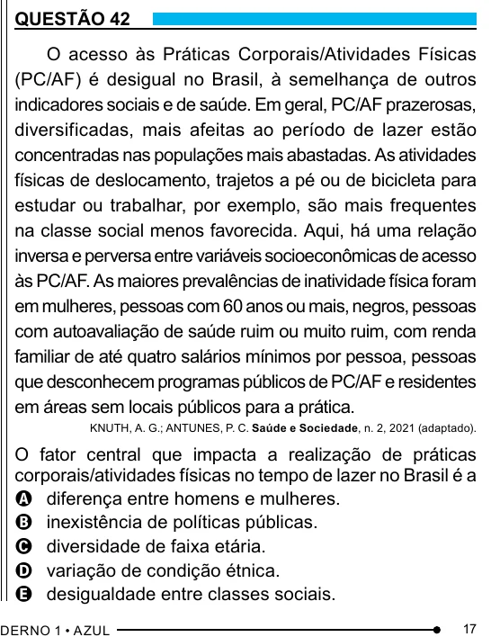

Texto extraído (pode conter ruído)

QUESTÃO 42  
O acesso às Práticas Corporais/Atividades Físicas  
(PC/AF) é desigual no Brasil, à semelhança de outros  
indicadores sociais e de saúde. Em geral, PC/AF prazerosas,  
diversificadas, mais afeitas ao período de lazer estão  
concentradas nas populações mais abastadas. As atividades  
físicas de deslocamento, trajetos a pé ou de bicicleta para  
estudar ou trabalhar, por exemplo, são mais frequentes  
na classe social menos favorecida. Aqui, há uma relação  
inversa e perversa entre variáveis socioeconômicas de acesso  
às PC/AF. As maiores prevalências de inatividade física foram  
em mulheres, pessoas com 60 anos ou mais, negros, pessoas  
com autoavaliação de saúde ruim ou muito ruim, com renda  
familiar de até quatro salários mínimos por pessoa, pessoas  
que desconhecem programas públicos de PC/AF e residentes  
em áreas sem locais públicos para a prática.  
KNUTH, A. G.; ANTUNES, P. C. Saúde e Sociedade, n. 2, 2021 (adaptado).  
O fator central que impacta a realização de práticas  
corporais/atividades físicas no tempo de lazer no Brasil é a  
A diferença entre homens e mulheres.  
B inexistência de políticas públicas.  
C diversidade de faixa etária.  
D variação de condição étnica.  
E desigualdade entre classes sociais.  
17

