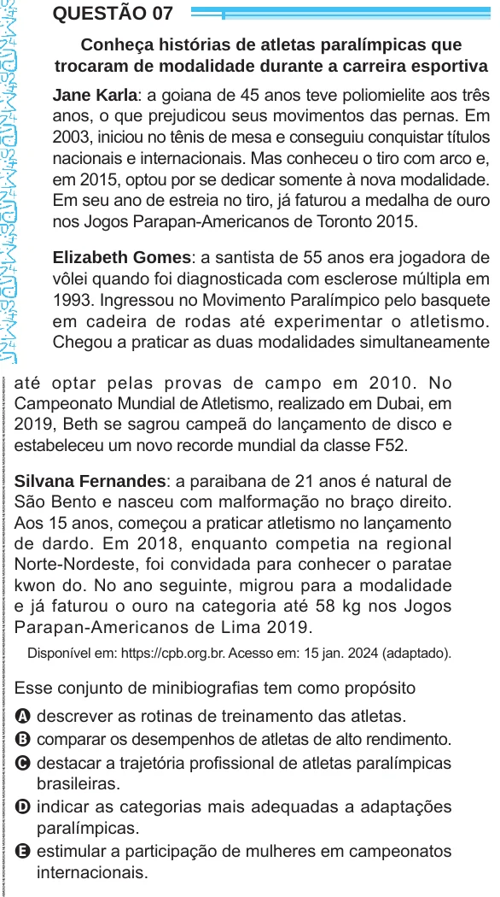

Texto extraído (pode conter ruído)

QUESTÃO 07  
Conheça histórias de atletas paralímpicas que  
trocaram de modalidade durante a carreira esportiva  
Jane Karla: a goiana de 45 anos teve poliomielite aos três  
anos, o que prejudicou seus movimentos das pernas. Em  
2003, iniciou no tênis de mesa e conseguiu conquistar títulos  
nacionais e internacionais. Mas conheceu o tiro com arco e,  
em 2015, optou por se dedicar somente à nova modalidade.  
Em seu ano de estreia no tiro, já faturou a medalha de ouro  
nos Jogos Parapan-Americanos de Toronto 2015.  
Elizabeth Gomes: a santista de 55 anos era jogadora de  
vôlei quando foi diagnosticada com esclerose múltipla em  
1993. Ingressou no Movimento Paralímpico pelo basquete  
em cadeira de rodas até experimentar o atletismo.  
Chegou a praticar as duas modalidades simultaneamente  
até optar pelas provas de campo em 2010. No  
Campeonato Mundial de Atletismo, realizado em Dubai, em  
2019, Beth se sagrou campeã do lançamento de disco e  
estabeleceu um novo recorde mundial da classe F52.  
Silvana Fernandes: a paraibana de 21 anos é natural de  
São Bento e nasceu com malformação no braço direito.  
Aos 15 anos, começou a praticar atletismo no lançamento  
de dardo. Em 2018, enquanto competia na regional  
Norte-Nordeste, foi convidada para conhecer o paratae  
kwon do. No ano seguinte, migrou para a modalidade  
e já faturou o ouro na categoria até 58 kg nos Jogos  
Parapan-Americanos de Lima 2019.  
Disponível em: https://cpb.org.br. Acesso em: 15 jan. 2024 (adaptado).  
Esse conjunto de minibiografias tem como propósito  
A descrever as rotinas de treinamento das atletas.  
B comparar os desempenhos de atletas de alto rendimento.  
C destacar a trajetória profissional de atletas paralímpicas  
brasileiras.  
D indicar as categorias mais adequadas a adaptações  
paralímpicas.  
E estimular a participação de mulheres em campeonatos  
internacionais.

