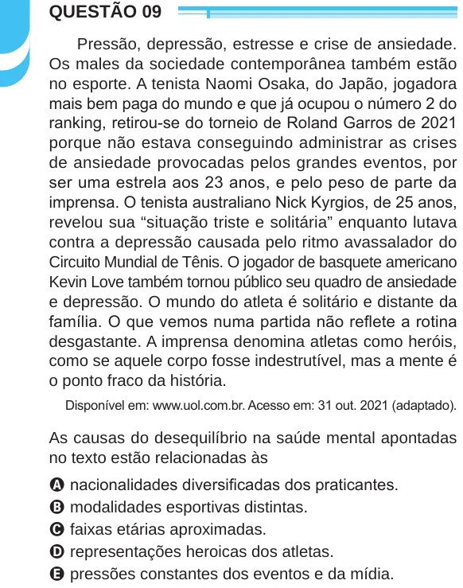

Texto extraído (pode conter ruído)

QUESTÃO 09  
Pressão, depressão, estresse e crise de ansiedade.  
Os males da sociedade contemporânea também estão  
no esporte. A tenista Naomi Osaka, do Japão, jogadora  
mais bem paga do mundo e que já ocupou o número 2 do  
ranking, retirou-se do torneio de Roland Garros de 2021  
porque não estava conseguindo administrar as crises  
de ansiedade provocadas pelos grandes eventos, por  
ser uma estrela aos 23 anos, e pelo peso de parte da  
imprensa. O tenista australiano Nick Kyrgios, de 25 anos,  
revelou sua “situação triste e solitária” enquanto lutava  
contra a depressão causada pelo ritmo avassalador do  
Circuito Mundial de Tênis. O jogador de basquete americano  
Kevin Love também tornou público seu quadro de ansiedade  
e depressão. O mundo do atleta é solitário e distante da  
família. O que vemos numa partida não reflete a rotina  
desgastante. A imprensa denomina atletas como heróis,  
como se aquele corpo fosse indestrutível, mas a mente é  
o ponto fraco da história.  
Disponível em: www.uol.com.br. Acesso em: 31 out. 2021 (adaptado).  
As causas do desequilíbrio na saúde mental apontadas  
no texto estão relacionadas às  
A nacionalidades diversificadas dos praticantes.  
B modalidades esportivas distintas.  
C faixas etárias aproximadas.  
D representações heroicas dos atletas.  
E pressões constantes dos eventos e da mídia.

