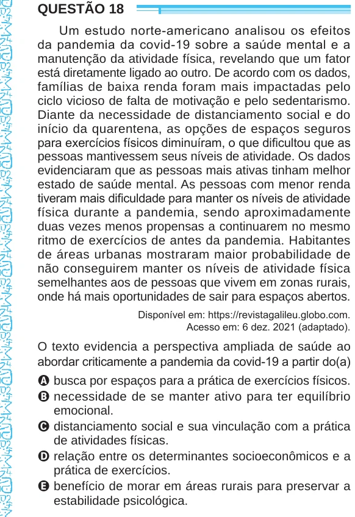

Texto extraído (pode conter ruído)

QUESTÃO 18  
Um estudo norte-americano analisou os efeitos  
da pandemia da covid-19 sobre a saúde mental e a  
manutenção da atividade física, revelando que um fator  
está diretamente ligado ao outro. De acordo com os dados,  
famílias de baixa renda foram mais impactadas pelo  
ciclo vicioso de falta de motivação e pelo sedentarismo.  
Diante da necessidade de distanciamento social e do  
início da quarentena, as opções de espaços seguros  
para exercícios físicos diminuíram, o que dificultou que as  
pessoas mantivessem seus níveis de atividade. Os dados  
evidenciaram que as pessoas mais ativas tinham melhor  
estado de saúde mental. As pessoas com menor renda  
tiveram mais dificuldade para manter os níveis de atividade  
física durante a pandemia, sendo aproximadamente  
duas vezes menos propensas a continuarem no mesmo  
ritmo de exercícios de antes da pandemia. Habitantes  
de áreas urbanas mostraram maior probabilidade de  
não conseguirem manter os níveis de atividade física  
semelhantes aos de pessoas que vivem em zonas rurais,  
onde há mais oportunidades de sair para espaços abertos.  
Disponível em: https://revistagalileu.globo.com.  
Acesso em: 6 dez. 2021 (adaptado).  
O texto evidencia a perspectiva ampliada de saúde ao  
abordar criticamente a pandemia da covid-19 a partir do(a)  
A busca por espaços para a prática de exercícios físicos.  
B necessidade de se manter ativo para ter equilíbrio  
emocional.  
C distanciamento social e sua vinculação com a prática  
de atividades físicas.  
D relação entre os determinantes socioeconômicos e a  
prática de exercícios.  
E benefício de morar em áreas rurais para preservar a  
estabilidade psicológica.

