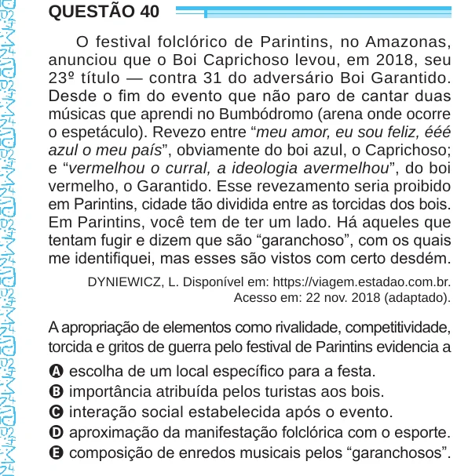

Texto extraído (pode conter ruído)

QUESTÃO 40  
O festival folclórico de Parintins, no Amazonas,  
anunciou que o Boi Caprichoso levou, em 2018, seu  
23 º título — contra 31 do adversário Boi Garantido.  
Desde o fim do evento que não paro de cantar duas  
músicas que aprendi no Bumbódromo (arena onde ocorre  
o espetáculo). Revezo entre “meu amor, eu sou feliz, ééé  
azul o meu país”, obviamente do boi azul, o Caprichoso;  
e “vermelhou o curral, a ideologia avermelhou”, do boi  
vermelho, o Garantido. Esse revezamento seria proibido  
em Parintins, cidade tão dividida entre as torcidas dos bois.  
Em Parintins, você tem de ter um lado. Há aqueles que  
tentam fugir e dizem que são “garanchoso”, com os quais  
me identifiquei, mas esses são vistos com certo desdém.  
DYNIEWICZ, L. Disponível em: https://viagem.estadao.com.br.  
Acesso em: 22 nov. 2018 (adaptado).  
A apropriação de elementos como rivalidade, competitividade,  
torcida e gritos de guerra pelo festival de Parintins evidencia a  
A escolha de um local específico para a festa.  
B importância atribuída pelos turistas aos bois.  
C interação social estabelecida após o evento.  
D aproximação da manifestação folclórica com o esporte.  
E composição de enredos musicais pelos “garanchosos”.

