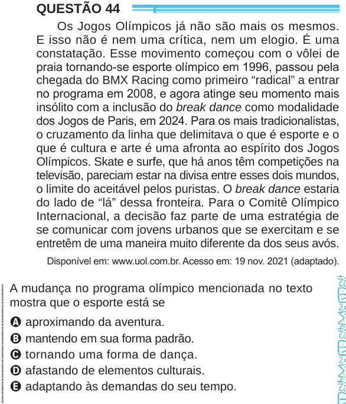

Texto extraído (pode conter ruído)

QUESTÃO 44  
Os Jogos Olímpicos já não são mais os mesmos.  
E isso não é nem uma crítica, nem um elogio. É uma  
constatação. Esse movimento começou com o vôlei de  
praia tornando-se esporte olímpico em 1996, passou pela  
chegada do BMX Racing como primeiro “radical” a entrar  
no programa em 2008, e agora atinge seu momento mais  
insólito com a inclusão do break dance como modalidade  
dos Jogos de Paris, em 2024. Para os mais tradicionalistas,  
o cruzamento da linha que delimitava o que é esporte e o  
que é cultura e arte é uma afronta ao espírito dos Jogos  
Olímpicos. Skate e surfe, que há anos têm competições na  
televisão, pareciam estar na divisa entre esses dois mundos,  
o limite do aceitável pelos puristas. O break dance estaria  
do lado de “lá” dessa fronteira. Para o Comitê Olímpico  
Internacional, a decisão faz parte de uma estratégia de  
se comunicar com jovens urbanos que se exercitam e se  
entretêm de uma maneira muito diferente da dos seus avós.  
Disponível em: www.uol.com.br. Acesso em: 19 nov. 2021 (adaptado).  
A mudança no programa olímpico mencionada no texto  
mostra que o esporte está se  
A aproximando da aventura.  
B mantendo em sua forma padrão.  
C tornando uma forma de dança.  
D afastando de elementos culturais.  
E adaptando às demandas do seu tempo.

