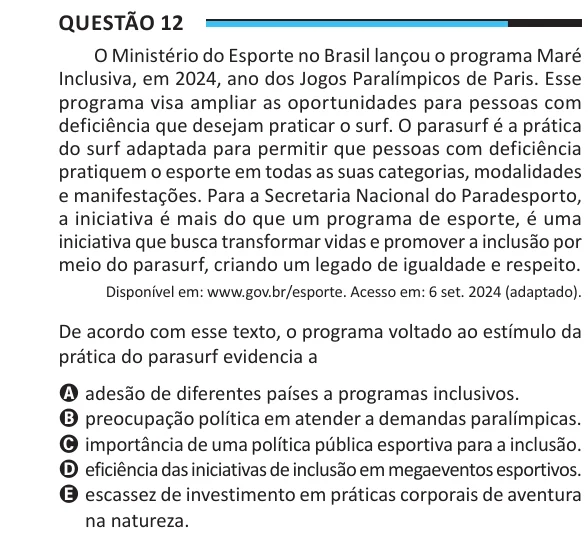

Texto extraído (pode conter ruído)

Questão 12  
O Ministério do Esporte no Brasil lançou o programa Maré  
Inclusiva, em 2024, ano dos Jogos Paralímpicos de Paris. Esse  
programa visa ampliar as oportunidades para pessoas com  
deficiência que desejam praticar o surf. O parasurf é a prática  
do surf adaptada para permitir que pessoas com deficiência  
pratiquem o esporte em todas as suas categorias, modalidades  
e manifestações. Para a Secretaria Nacional do Paradesporto,  
a iniciativa é mais do que um programa de esporte, é uma  
iniciativa que busca transformar vidas e promover a inclusão por  
meio do parasurf, criando um legado de igualdade e respeito.  
Disponível em: www.gov.br/esporte. Acesso em: 6 set. 2024 (adaptado).  
De acordo com esse texto, o programa voltado ao estímulo da  
prática do parasurf evidencia a  
A adesão de diferentes países a programas inclusivos.  
B preocupação política em atender a demandas paralímpicas.  
C importância de uma política pública esportiva para a inclusão.  
D eficiência das iniciativas de inclusão em megaeventos esportivos.  
E escassez de investimento em práticas corporais de aventura  
na natureza.

