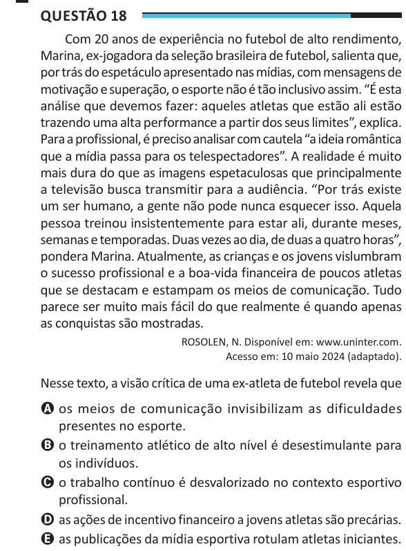

Texto extraído (pode conter ruído)

Questão 18  
Com 20 anos de experiência no futebol de alto rendimento,  
Marina, ex-jogadora da seleção brasileira de futebol, salienta que,  
por trás do espetáculo apresentado nas mídias, com mensagens de  
motivação e superação, o esporte não é tão inclusivo assim. “É esta  
análise que devemos fazer: aqueles atletas que estão ali estão  
trazendo uma alta performance a partir dos seus limites”, explica.  
Para a profissional, é preciso analisar com cautela “a ideia romântica  
que a mídia passa para os telespectadores”. A realidade é muito  
mais dura do que as imagens espetaculosas que principalmente  
a televisão busca transmitir para a audiência. “Por trás existe  
um ser humano, a gente não pode nunca esquecer isso. Aquela  
pessoa treinou insistentemente para estar ali, durante meses,  
semanas e temporadas. Duas vezes ao dia, de duas a quatro horas”,  
pondera Marina. Atualmente, as crianças e os jovens vislumbram  
o sucesso profissional e a boa-vida financeira de poucos atletas  
que se destacam e estampam os meios de comunicação. Tudo  
parece ser muito mais fácil do que realmente é quando apenas  
as conquistas são mostradas.  
ROSOLEN, N. Disponível em: www.uninter.com.  
Acesso em: 10 maio 2024 (adaptado).  
Nesse texto, a visão crítica de uma ex-atleta de futebol revela que  
A os meios de comunicação invisibilizam as dificuldades  
presentes no esporte.  
B o treinamento atlético de alto nível é desestimulante para  
os indivíduos.  
C o trabalho contínuo é desvalorizado no contexto esportivo  
profissional.  
D as ações de incentivo financeiro a jovens atletas são precárias.  
E as publicações da mídia esportiva rotulam atletas iniciantes.

