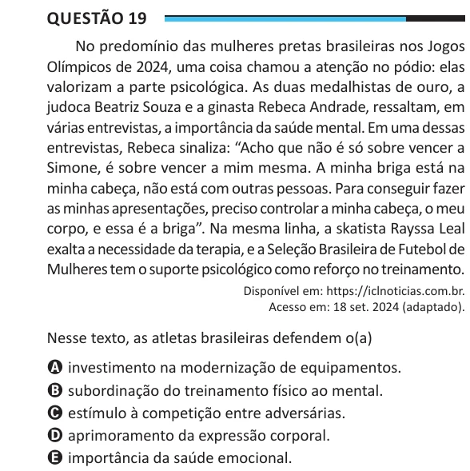

Texto extraído (pode conter ruído)

Questão 19  
No predomínio das mulheres pretas brasileiras nos Jogos  
Olímpicos de 2024, uma coisa chamou a atenção no pódio: elas  
valorizam a parte psicológica. As duas medalhistas de ouro, a  
judoca Beatriz Souza e a ginasta Rebeca Andrade, ressaltam, em  
várias entrevistas, a importância da saúde mental. Em uma dessas  
entrevistas, Rebeca sinaliza: “Acho que não é só sobre vencer a  
Simone, é sobre vencer a mim mesma. A minha briga está na  
minha cabeça, não está com outras pessoas. Para conseguir fazer  
as minhas apresentações, preciso controlar a minha cabeça, o meu  
corpo, e essa é a briga”. Na mesma linha, a skatista Rayssa Leal  
exalta a necessidade da terapia, e a Seleção Brasileira de Futebol de  
Mulheres tem o suporte psicológico como reforço no treinamento.  
Disponível em: https://iclnoticias.com.br.  
Acesso em: 18 set. 2024 (adaptado).  
Nesse texto, as atletas brasileiras defendem o(a)  
A investimento na modernização de equipamentos.  
B subordinação do treinamento físico ao mental.  
C estímulo à competição entre adversárias.  
D aprimoramento da expressão corporal.  
E importância da saúde emocional.

