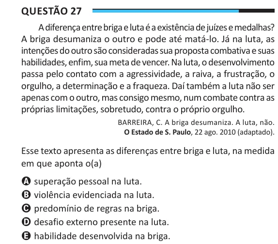

Texto extraído (pode conter ruído)

Questão 27  
A diferença entre briga e luta é a existência de juízes e medalhas?  
A briga desumaniza o outro e pode até matá-lo. Já na luta, as  
intenções do outro são consideradas sua proposta combativa e suas  
habilidades, enfim, sua meta de vencer. Na luta, o desenvolvimento  
passa pelo contato com a agressividade, a raiva, a frustração, o  
orgulho, a determinação e a fraqueza. Daí também a luta não ser  
apenas com o outro, mas consigo mesmo, num combate contra as  
próprias limitações, sobretudo, contra o próprio orgulho.  
BARREIRA, C. A briga desumaniza. A luta, não.  
O Estado de S. Paulo, 22 ago. 2010 (adaptado).  
Esse texto apresenta as diferenças entre briga e luta, na medida  
em que aponta o(a)  
A superação pessoal na luta.  
B violência evidenciada na luta.  
C predomínio de regras na briga.  
D desafio externo presente na luta.  
E habilidade desenvolvida na briga.

