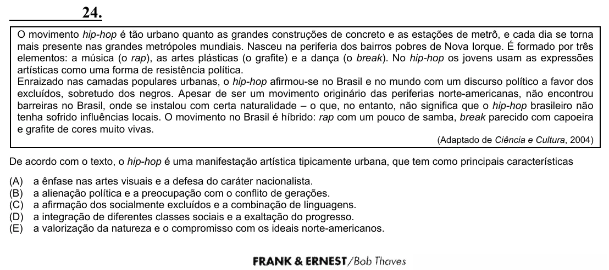

Texto extraído (pode conter ruído)

24.  
O movimento hip-hop é tão urbano quanto as grandes construções de concreto e as estações de metrô, e cada dia se torna  
mais presente nas grandes metrópoles mundiais. Nasceu na periferia dos bairros pobres de Nova Iorque. É formado por três  
elementos: a música (o rap), as artes plásticas (o grafite) e a dança (o break). No hip-hop os jovens usam as expressões  
artísticas como uma forma de resistência política.  
Enraizado nas camadas populares urbanas, o hip-hop afirmou-se no Brasil e no mundo com um discurso político a favor dos  
excluídos, sobretudo dos negros. Apesar de ser um movimento originário das periferias norte-americanas, não encontrou  
barreiras no Brasil, onde se instalou com certa naturalidade – o que, no entanto, não significa que o hip-hop brasileiro não  
tenha sofrido influências locais. O movimento no Brasil é híbrido: rap com um pouco de samba, break parecido com capoeira  
e grafite de cores muito vivas.  
(Adaptado de Ciência e Cultura, 2004)  
De acordo com o texto, o hip-hop é uma manifestação artística tipicamente urbana, que tem como principais características  
(A)  
a ênfase nas artes visuais e a defesa do caráter nacionalista.  
(B)  
a alienação política e a preocupação com o conflito de gerações.  
(C)  
a afirmação dos socialmente excluídos e a combinação de linguagens.  
(D)  
a integração de diferentes classes sociais e a exaltação do progresso.  
(E)  
a valorização da natureza e o compromisso com os ideais norte-americanos.

