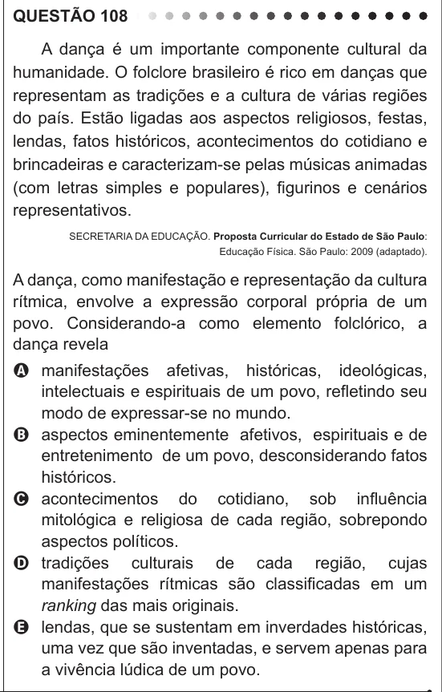

Texto extraído (pode conter ruído)

QUESTÃO 108  
A dança é um importante componente cultural da  
humanidade. O folclore brasileiro é rico em danças que  
representam as tradições e a cultura de várias regiões  
do país. Estão ligadas aos aspectos religiosos, festas,  
lendas, fatos históricos, acontecimentos do cotidiano e  
brincadeiras e caracterizam-se pelas músicas animadas  
(com letras simples e populares), figurinos e cenários  
representativos.  
SECRETARIA DA EDUCAÇÃO. Proposta Curricular do Estado de São Paulo:  
Educação Física. São Paulo: 2009 (adaptado).  
A dança, como manifestação e representação da cultura  
rítmica, envolve a expressão corporal própria de um  
povo. Considerando-a como elemento folclórico, a  
dança revela  
A manifestações afetivas, históricas, ideológicas,  
intelectuais e espirituais de um povo, refletindo seu  
modo de expressar-se no mundo.  
B aspectos eminentemente afetivos, espirituais e de  
entretenimento de um povo, desconsiderando fatos  
históricos.  
C acontecimentos do cotidiano, sob influência  
mitológica e religiosa de cada região, sobrepondo  
aspectos políticos.  
D tradições culturais de cada região, cujas  
manifestações rítmicas são classificadas em um  
ranking das mais originais.  
E lendas, que se sustentam em inverdades históricas,  
uma vez que são inventadas, e servem apenas para  
a vivência lúdica de um povo.

