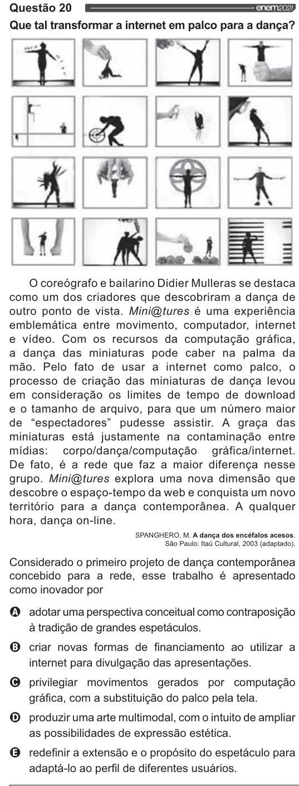

Texto extraído (pode conter ruído)

Questão 20  
enem2021  
Que tal transformar a internet em palco para a dança?  
O coreógrafo e bailarino Didier Mulleras se destaca  
como um dos criadores que descobriram a dança de  
outro ponto de vista. MiniDtures é uma experiência  
emblemática entre movimento, computador, internet  
e vídeo. Com os recursos da computação gráfica,  
a dança das miniaturas pode caber na palma da  
mão. Pelo fato de usar a internet como palco, o  
processo de criação das miniaturas de dança levou  
em consideração os limites de tempo de download  
e o tamanho de arquivo, para que um número maior  
de “espectadores” pudesse assistir. A graça das  
miniaturas está justamente na contaminação entre  
mídias: corpo/dança/computação  gráfica/internet.  
De fato, é a rede que faz a maior diferença nesse  
grupo. MiniDtures explora uma nova dimensão que  
descobre o espaço-tempo da web e conquista um novo  
território para a dança contemporânea. A qualquer  
hora, dança on-line.  
SPANGHERO, M. A dança dos encéfalos acesos.  
São Paulo: Itaú Cultural, 2003 (adaptado).  
Considerado o primeiro projeto de dança contemporânea  
concebido para a rede, esse trabalho é apresentado  
como inovador por  
OQ adotar uma perspectiva conceitual como contraposição  
à tradição de grandes espetáculos.  
O criar novas formas de financiamento ao utilizar a  
internet para divulgação das apresentações.  
O privilegiar movimentos gerados por computação  
gráfica, com a substituição do palco pela tela.  
O produzir uma arte multimodal, com o intuito de ampliar  
as possibilidades de expressão estética.  
Q redefinir a extensão e o propósito do espetáculo para  
adaptá-lo ao perfil de diferentes usuários.

