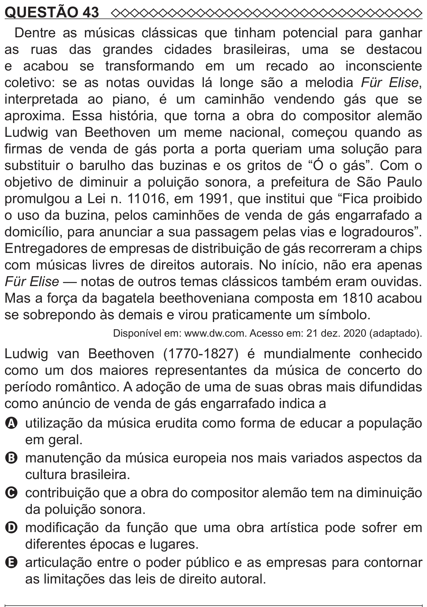

Texto extraído (pode conter ruído)

QUESTÃO 43  
Dentre as músicas clássicas que tinham potencial para ganhar  
as ruas das grandes cidades brasileiras, uma se destacou  
e acabou se transformando em um recado ao inconsciente  
coletivo: se as notas ouvidas lá longe são a melodia Für Elise,  
interpretada ao piano, é um caminhão vendendo gás que se  
aproxima. Essa história, que torna a obra do compositor alemão  
Ludwig van Beethoven um meme nacional, começou quando as  
firmas de venda de gás porta a porta queriam uma solução para  
substituir o barulho das buzinas e os gritos de “Ó o gás”. Com o  
objetivo de diminuir a poluição sonora, a prefeitura de São Paulo  
promulgou a Lei n. 11 016, em 1991, que institui que “Fica proibido  
o uso da buzina, pelos caminhões de venda de gás engarrafado a  
domicílio, para anunciar a sua passagem pelas vias e logradouros”.  
Entregadores de empresas de distribuição de gás recorreram a chips  
com músicas livres de direitos autorais. No início, não era apenas  
Für Elise — notas de outros temas clássicos também eram ouvidas.  
Mas a força da bagatela beethoveniana composta em 1810 acabou  
se sobrepondo às demais e virou praticamente um símbolo.  
Disponível em: www.dw.com. Acesso em: 21 dez. 2020 (adaptado).  
Ludwig van Beethoven (1770-1827) é mundialmente conhecido  
como um dos maiores representantes da música de concerto do  
período romântico. A adoção de uma de suas obras mais difundidas  
como anúncio de venda de gás engarrafado indica a  
A utilização da música erudita como forma de educar a população  
em geral.  
B manutenção da música europeia nos mais variados aspectos da  
cultura brasileira.  
C contribuição que a obra do compositor alemão tem na diminuição  
da poluição sonora.  
D modificação da função que uma obra artística pode sofrer em  
diferentes épocas e lugares.  
E articulação entre o poder público e as empresas para contornar  
as limitações das leis de direito autoral.

