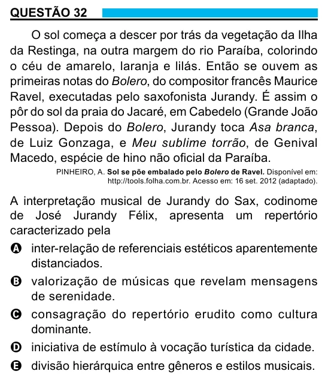

Texto extraído (pode conter ruído)

QUESTÃO 32  
O sol começa a descer por trás da vegetação da Ilha  
da Restinga, na outra margem do rio Paraíba, colorindo  
o céu de amarelo, laranja e lilás. Então se ouvem as  
primeiras notas do Bolero, do compositor francês Maurice  
Ravel, executadas pelo saxofonista Jurandy. É assim o  
pôr do sol da praia do Jacaré, em Cabedelo (Grande João  
Pessoa). Depois do Bolero, Jurandy toca Asa branca,  
de Luiz Gonzaga, e Meu sublime torrão, de Genival  
Macedo, espécie de hino não oficial da Paraíba.  
PINHEIRO, A. Sol se põe embalado pelo Bolero de Ravel. Disponível em:  
http://tools.folha.com.br. Acesso em: 16 set. 2012 (adaptado).  
A interpretação musical de Jurandy do Sax, codinome  
de José Jurandy Félix, apresenta um repertório  
caracterizado pela  
A inter-relação de referenciais estéticos aparentemente  
distanciados.  
B valorização de músicas que revelam mensagens  
de serenidade.  
C consagração do repertório erudito como cultura  
dominante.  
D iniciativa de estímulo à vocação turística da cidade.  
E divisão hierárquica entre gêneros e estilos musicais.

