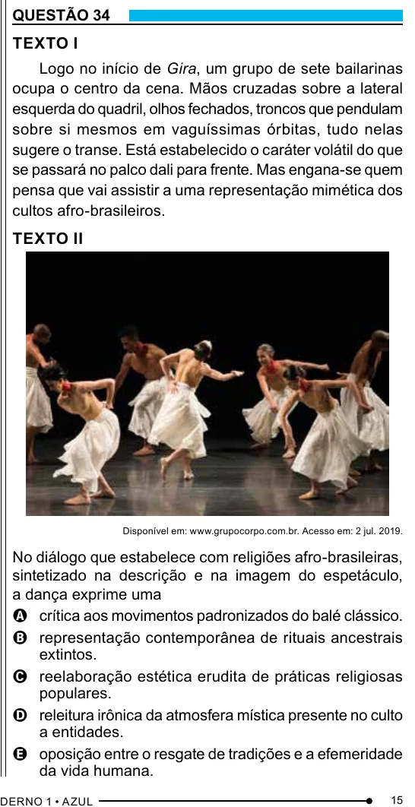

Texto extraído (pode conter ruído)

QUESTÃO 34  
TEXTO I  
Logo no início de Gira, um grupo de sete bailarinas  
ocupa o centro da cena. Mãos cruzadas sobre a lateral  
esquerda do quadril, olhos fechados, troncos que pendulam  
sobre si mesmos em vaguíssimas órbitas, tudo nelas  
sugere o transe. Está estabelecido o caráter volátil do que  
se passará no palco dali para frente. Mas engana-se quem  
pensa que vai assistir a uma representação mimética dos  
cultos afro-brasileiros.  
TEXTO II  
Disponível em: www.grupocorpo.com.br. Acesso em: 2 jul. 2019.  
No diálogo que estabelece com religiões afro-brasileiras,  
sintetizado na descrição e na imagem do espetáculo,  
a dança exprime uma  
A crítica aos movimentos padronizados do balé clássico.  
B representação contemporânea de rituais ancestrais  
extintos.  
C reelaboração estética erudita de práticas religiosas  
populares.  
D releitura irônica da atmosfera mística presente no culto  
a entidades.  
E oposição entre o resgate de tradições e a efemeridade  
da vida humana.  
15

