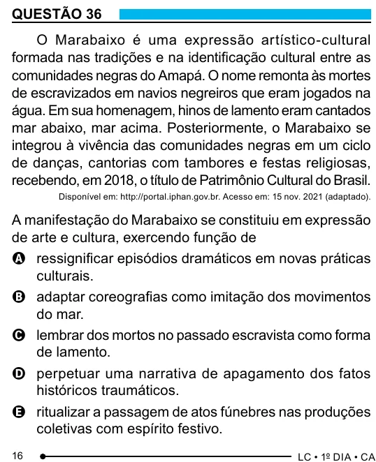

Texto extraído (pode conter ruído)

QUESTÃO 36  
O Marabaixo é uma expressão artístico-cultural  
formada nas tradições e na identificação cultural entre as  
comunidades negras do Amapá. O nome remonta às mortes  
de escravizados em navios negreiros que eram jogados na  
água. Em sua homenagem, hinos de lamento eram cantados  
mar abaixo, mar acima. Posteriormente, o Marabaixo se  
integrou à vivência das comunidades negras em um ciclo  
de danças, cantorias com tambores e festas religiosas,  
recebendo, em 2018, o título de Patrimônio Cultural do Brasil.  
Disponível em: http://portal.iphan.gov.br. Acesso em: 15 nov. 2021 (adaptado).  
A manifestação do Marabaixo se constituiu em expressão  
de arte e cultura, exercendo função de  
A ressignificar episódios dramáticos em novas práticas  
culturais.  
B adaptar coreografias como imitação dos movimentos  
do mar.  
C lembrar dos mortos no passado escravista como forma  
de lamento.  
D perpetuar uma narrativa de apagamento dos fatos  
históricos traumáticos.  
E ritualizar a passagem de atos fúnebres nas produções  
coletivas com espírito festivo.  
16

