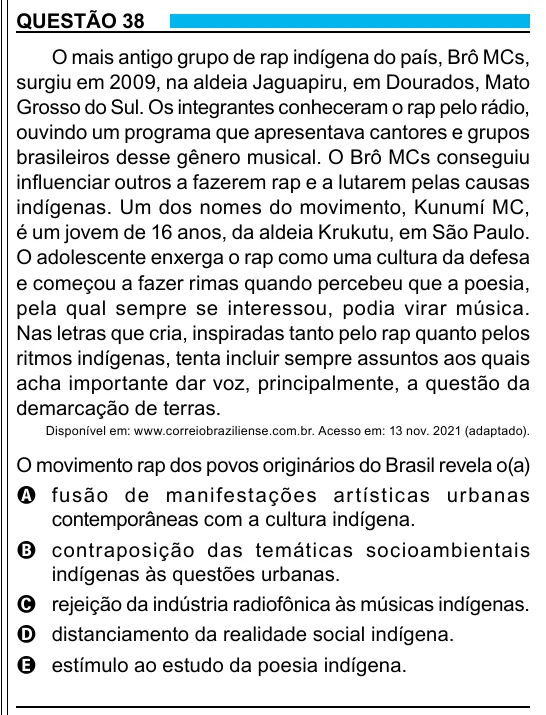

Texto extraído (pode conter ruído)

QUESTÃO 38  
O mais antigo grupo de rap indígena do país, Brô MCs,  
surgiu em 2009, na aldeia Jaguapiru, em Dourados, Mato  
Grosso do Sul. Os integrantes conheceram o rap pelo rádio,  
ouvindo um programa que apresentava cantores e grupos  
brasileiros desse gênero musical. O Brô MCs conseguiu  
influenciar outros a fazerem rap e a lutarem pelas causas  
indígenas. Um dos nomes do movimento, Kunumí MC,  
é um jovem de 16 anos, da aldeia Krukutu, em São Paulo.  
O adolescente enxerga o rap como uma cultura da defesa  
e começou a fazer rimas quando percebeu que a poesia,  
pela qual sempre se interessou, podia virar música.  
Nas letras que cria, inspiradas tanto pelo rap quanto pelos  
ritmos indígenas, tenta incluir sempre assuntos aos quais  
acha importante dar voz, principalmente, a questão da  
demarcação de terras.  
Disponível em: www.correiobraziliense.com.br. Acesso em: 13 nov. 2021 (adaptado).  
O movimento rap dos povos originários do Brasil revela o(a)  
A fusão de manifestações ar tísticas urbanas  
contemporâneas com a cultura indígena.  
B contraposição das temáticas socioambientais  
indígenas às questões urbanas.  
C rejeição da indústria radiofônica às músicas indígenas.  
D distanciamento da realidade social indígena.  
E estímulo ao estudo da poesia indígena.

