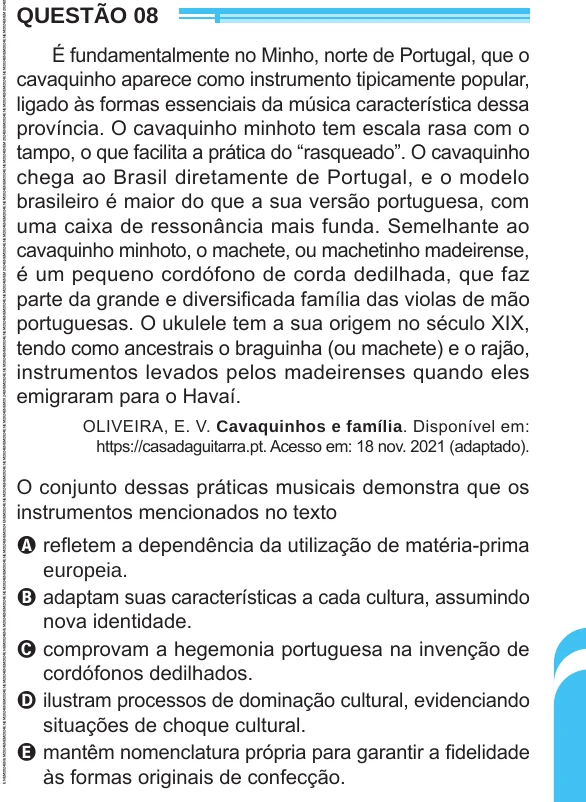

Texto extraído (pode conter ruído)

QUESTÃO 08  
É fundamentalmente no Minho, norte de Portugal, que o  
cavaquinho aparece como instrumento tipicamente popular,  
ligado às formas essenciais da música característica dessa  
província. O cavaquinho minhoto tem escala rasa com o  
tampo, o que facilita a prática do “rasqueado”. O cavaquinho  
chega ao Brasil diretamente de Portugal, e o modelo  
brasileiro é maior do que a sua versão portuguesa, com  
uma caixa de ressonância mais funda. Semelhante ao  
cavaquinho minhoto, o machete, ou machetinho madeirense,  
é um pequeno cordófono de corda dedilhada, que faz  
parte da grande e diversificada família das violas de mão  
portuguesas. O ukulele tem a sua origem no século XIX,  
tendo como ancestrais o braguinha (ou machete) e o rajão,  
instrumentos levados pelos madeirenses quando eles  
emigraram para o Havaí.  
OLIVEIRA, E. V. Cavaquinhos e família. Disponível em:  
https://casadaguitarra.pt. Acesso em: 18 nov. 2021 (adaptado).  
O conjunto dessas práticas musicais demonstra que os  
instrumentos mencionados no texto  
A refletem a dependência da utilização de matéria-prima  
europeia.  
B adaptam suas características a cada cultura, assumindo  
nova identidade.  
C comprovam a hegemonia portuguesa na invenção de  
cordófonos dedilhados.  
D ilustram processos de dominação cultural, evidenciando  
situações de choque cultural.  
E mantêm nomenclatura própria para garantir a fidelidade  
às formas originais de confecção.

