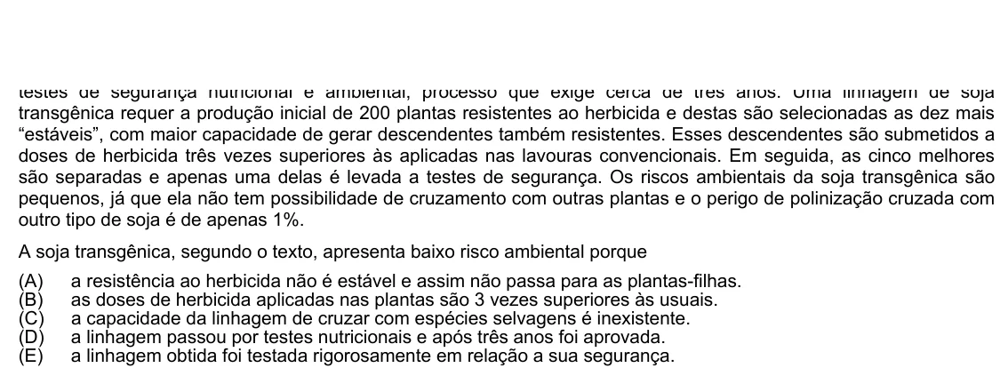

Texto extraído (pode conter ruído)

transgênica requer a produção inicial de 200 plantas resistentes ao herbicida e destas são selecionadas as dez mais  
“estáveis”, com maior capacidade de gerar descendentes também resistentes. Esses descendentes são submetidos a  
doses de herbicida três vezes superiores às aplicadas nas lavouras convencionais. Em seguida, as cinco melhores  
são separadas e apenas uma delas é levada a testes de segurança. Os riscos ambientais da soja transgênica são  
pequenos, já que ela não tem possibilidade de cruzamento com outras plantas e o perigo de polinização cruzada com  
outro tipo de soja é de apenas 1%.  
A soja transgênica, segundo o texto, apresenta baixo risco ambiental porque  
(A)  
a resistência ao herbicida não é estável e assim não passa para as plantas-filhas.  
(B)  
as doses de herbicida aplicadas nas plantas são 3 vezes superiores às usuais.  
(C)  
a capacidade da linhagem de cruzar com espécies selvagens é inexistente.  
(D)  
a linhagem passou por testes nutricionais e após três anos foi aprovada.  
(E)  
a linhagem obtida foi testada rigorosamente em relação a sua segurança.

