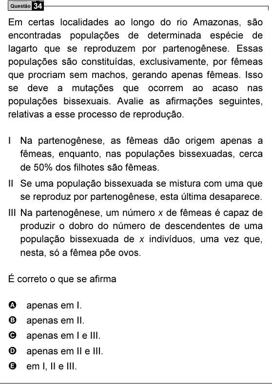

Texto extraído (pode conter ruído)

Questão 34  
Em certas localidades ao longo do rio Amazonas, são  
encontradas populações de determinada espécie de  
lagarto que se reproduzem por partenogênese. Essas  
populações são constituídas, exclusivamente, por fêmeas  
que procriam sem machos, gerando apenas fêmeas. Isso  
se deve a mutações que ocorrem ao acaso nas  
populações bissexuais. Avalie as afirmações seguintes,  
relativas a esse processo de reprodução.  
I Na partenogênese, as fêmeas dão origem apenas a  
fêmeas, enquanto, nas populações bissexuadas, cerca  
de 50% dos filhotes são fêmeas.  
II Se uma população bissexuada se mistura com uma que  
se reproduz por partenogênese, esta última desaparece.  
III Na partenogênese, um número x de fêmeas é capaz de  
produzir o dobro do número de descendentes de uma  
população bissexuada de x indivíduos, uma vez que,  
nesta, só a fêmea põe ovos.  
É correto o que se afirma  
A apenas em I.  
B apenas em II.  
C apenas em I e III.  
D apenas em II e III.  
E em I, II e III.

