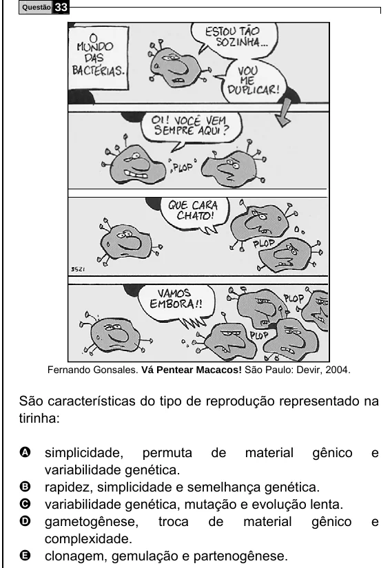

Texto extraído (pode conter ruído)

Questão  
33  
Fernando Gonsales. Vá Pentear Macacos! São Paulo: Devir, 2004.  
São características do tipo de reprodução representado na  
tirinha:  
A simplicidade,  
permuta de material gênico  
e  
variabilidade genética.  
rapidez, simplicidade e semelhança genética.  
B  
variabilidade genética, mutação e evolução lenta.  
C  
gametogênese, troca de material gênico  
e  
D  
complexidade.  
clonagem, gemulação e partenogênese.  
E

