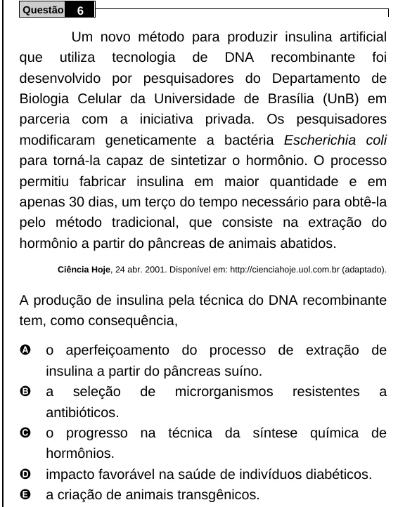

Texto extraído (pode conter ruído)

Questão  
6  
Um novo método para produzir insulina artificial  
que utiliza tecnologia de DNA recombinante foi  
desenvolvido por pesquisadores do Departamento de  
Biologia Celular da Universidade de Brasília (UnB) em  
parceria com a iniciativa privada. Os pesquisadores  
modificaram geneticamente a bactéria Escherichia coli  
para torná-la capaz de sintetizar o hormônio. O processo  
permitiu fabricar insulina em maior quantidade e em  
apenas 30 dias, um terço do tempo necessário para obtê-la  
pelo método tradicional, que consiste na extração do  
hormônio a partir do pâncreas de animais abatidos.  
Ciência Hoje, 24 abr. 2001. Disponível em: http://cienciahoje.uol.com.br (adaptado).  
A produção de insulina pela técnica do DNA recombinante  
tem, como consequência,  
A  
o aperfeiçoamento do processo de extração de  
insulina a partir do pâncreas suíno.  
B  
a seleção de microrganismos resistentes a  
antibióticos.  
C  
o progresso na técnica da síntese química de  
hormônios.  
D  
impacto favorável na saúde de indivíduos diabéticos.  
E  
a criação de animais transgênicos.

