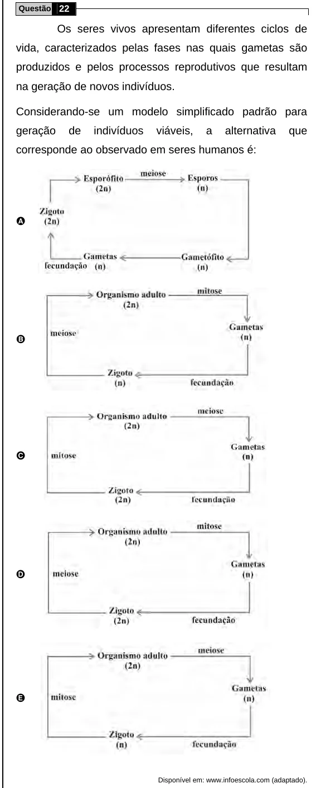

Texto extraído (pode conter ruído)

Questão 22  
Os seres vivos apresentam diferentes ciclos de  
vida, caracterizados pelas fases nas quais gametas são  
produzidos e pelos processos reprodutivos que resultam  
na geração de novos indivíduos.  
Considerando-se um modelo simplificado padrão para  
geração  
de  
indivíduos  
viáveis,  
a  
alternativa  
que  
corresponde ao observado em seres humanos é:  
A  
B  
C  
D  
E  
Disponível em: www.infoescola.com (adaptado).

