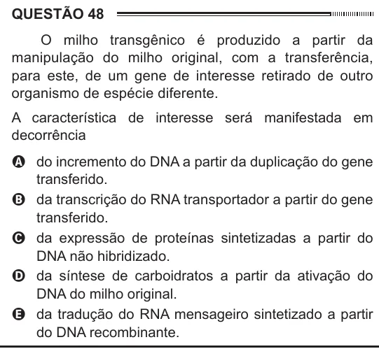

Texto extraído (pode conter ruído)

QUESTÃO 48  
O milho transgênico é produzido a partir da  
manipulação do milho original, com a transferência,  
para este, de um gene de interesse retirado de outro  
organismo de espécie diferente.  
A característica de interesse será manifestada em  
decorrência  
A do incremento do DNA a partir da duplicação do gene  
transferido.  
B da transcrição do RNA transportador a partir do gene  
transferido.  
C da expressão de proteínas sintetizadas a partir do  
DNA não hibridizado.  
D da síntese de carboidratos a partir da ativação do  
DNA do milho original.  
E da tradução do RNA mensageiro sintetizado a partir  
do DNA recombinante.

