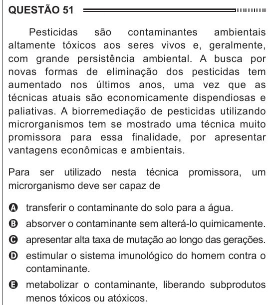

Texto extraído (pode conter ruído)

QUESTÃO 51  
Pesticidas  
são  
contaminantes  
ambientais  
altamente tóxicos aos seres vivos e, geralmente,  
com grande persistência ambiental. A busca por  
novas formas de eliminação dos pesticidas tem  
aumentado nos últimos anos, uma vez que as  
técnicas atuais são economicamente dispendiosas e  
paliativas. A biorremediação de pesticidas utilizando  
microrganismos tem se mostrado uma técnica muito  
promissora para essa finalidade, por apresentar  
vantagens econômicas e ambientais.  
Para ser utilizado nesta técnica  
promissora,  
um  
microrganismo deve ser capaz de  
A transferir o contaminante do solo para a água.  
B absorver o contaminante sem alterá-lo quimicamente.  
C apresentar alta taxa de mutação ao longo das gerações.  
D estimular o sistema imunológico do homem contra o  
contaminante.  
E metabolizar o contaminante, liberando subprodutos  
menos tóxicos ou atóxicos.

