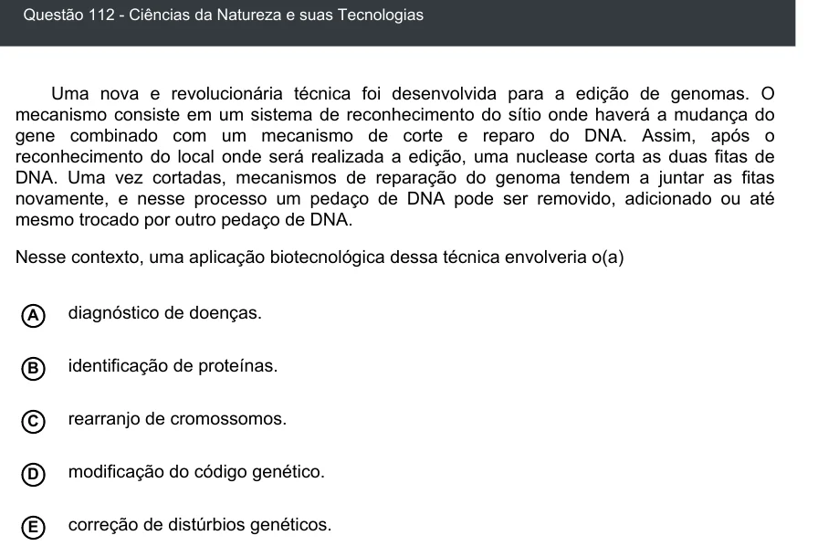

Texto extraído (pode conter ruído)

Questão 112 - Ciências da Natureza e suas Tecnologias  
Uma nova e revolucionária técnica foi desenvolvida para a edição de genomas. O  
mecanismo consiste em um sistema de reconhecimento do sítio onde haverá a mudança do  
gene combinado com um mecanismo de corte e reparo do DNA. Assim, após o  
reconhecimento do local onde será realizada a edição, uma nuclease corta as duas fitas de  
DNA. Uma vez cortadas, mecanismos de reparação do genoma tendem a juntar as fitas  
novamente, e nesse processo um pedaço de DNA pode ser removido, adicionado ou até  
mesmo trocado por outro pedaço de DNA.  
Nesse contexto, uma aplicação biotecnológica dessa técnica envolveria o(a)  
diagnóstico de doenças.  
A  
identificação de proteínas.  
B  
C  
rearranjo de cromossomos.  
modificação do código genético.  
D  
correção de distúrbios genéticos.  
E

