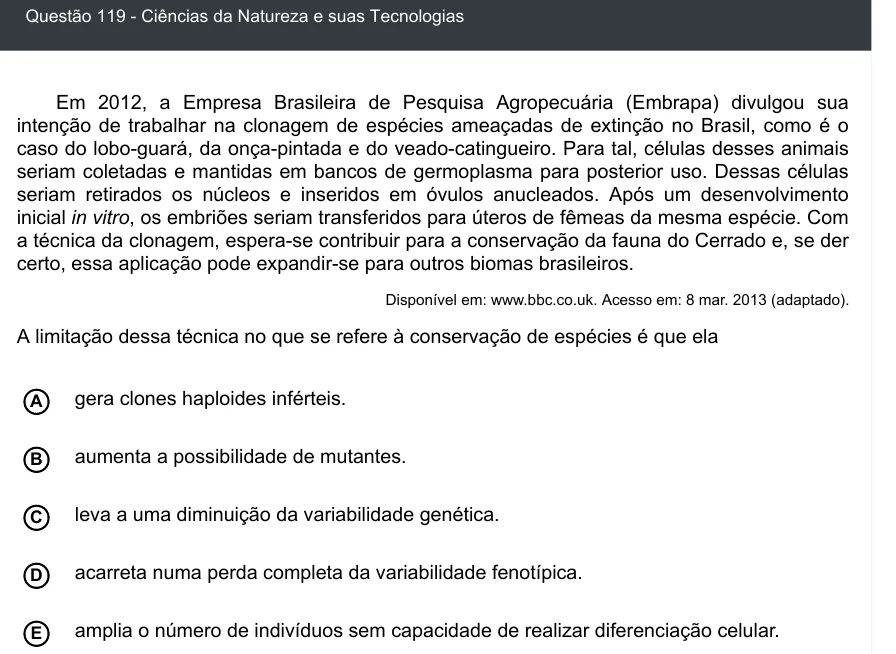

Texto extraído (pode conter ruído)

Questão 119 - Ciências da Natureza e suas Tecnologias  
Em 2012, a Empresa Brasileira de Pesquisa Agropecuária (Embrapa) divulgou sua  
intenção de trabalhar na clonagem de espécies ameaçadas de extinção no Brasil, como é o  
caso do lobo-guará, da onça-pintada e do veado-catingueiro. Para tal, células desses animais  
seriam coletadas e mantidas em bancos de germoplasma para posterior uso. Dessas células  
seriam retirados os núcleos e inseridos em óvulos anucleados. Após um desenvolvimento  
inicial in vitro, os embriões seriam transferidos para úteros de fêmeas da mesma espécie. Com  
a técnica da clonagem, espera-se contribuir para a conservação da fauna do Cerrado e, se der  
certo, essa aplicação pode expandir-se para outros biomas brasileiros.  
Disponível em: www.bbc.co.uk. Acesso em: 8 mar. 2013 (adaptado).  
A limitação dessa técnica no que se refere à conservação de espécies é que ela  
gera clones haploides inférteis.  
A  
aumenta a possibilidade de mutantes.  
B  
C  
leva a uma diminuição da variabilidade genética.  
acarreta numa perda completa da variabilidade fenotípica.  
D  
amplia o número de indivíduos sem capacidade de realizar diferenciação celular.  
E

