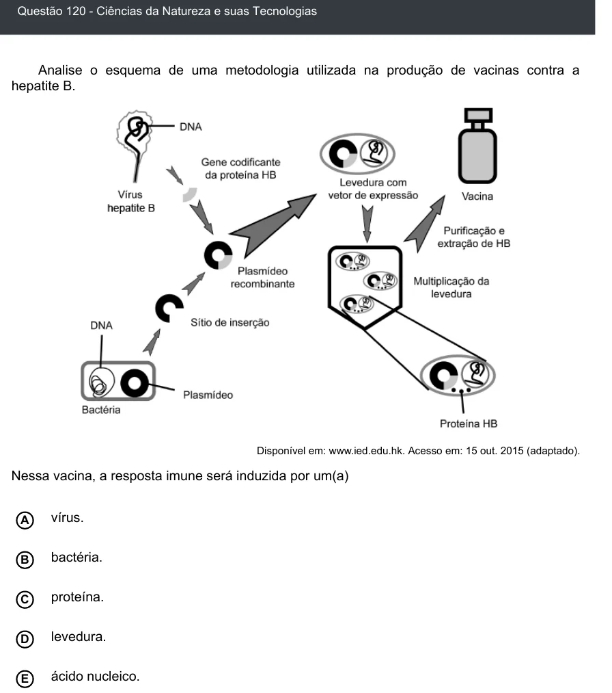

Texto extraído (pode conter ruído)

Questão 120 - Ciências da Natureza e suas Tecnologias  
Analise o esquema de uma metodologia utilizada na produção de vacinas contra a  
hepatite B.  
Disponível em: www.ied.edu.hk. Acesso em: 15 out. 2015 (adaptado).  
Nessa vacina, a resposta imune será induzida por um(a)  
A  
vírus.  
B  
bactéria.  
proteína.  
C  
levedura.  
D  
E  
ácido nucleico.

