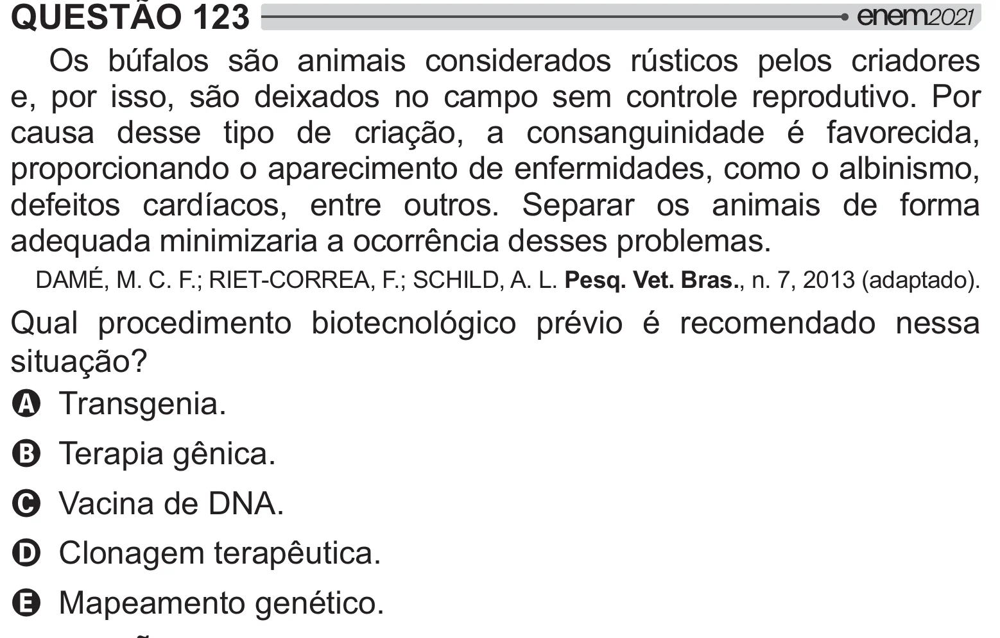

Texto extraído (pode conter ruído)

QUESTÃO 123  
Os búfalos são animais considerados rústicos pelos criadores  
e, por isso, são deixados no campo sem controle reprodutivo. Por  
causa desse tipo de criação, a consanguinidade é favorecida,  
proporcionando o aparecimento de enfermidades, como o albinismo,  
defeitos cardíacos, entre outros. Separar os animais de forma  
adequada minimizaria a ocorrência desses problemas.  
DAMÉ, M. C. F.; RIET-CORREA, F.; SCHILD, A. L. Pesq. Vet. Bras., n. 7, 2013 (adaptado).  
Qual procedimento biotecnológico prévio é recomendado nessa  
 =[]  
A Transgenia.  
B Terapia gênica.  
C Vacina de DNA.  
D Clonagem terapêutica.  
E Mapeamento genético.

