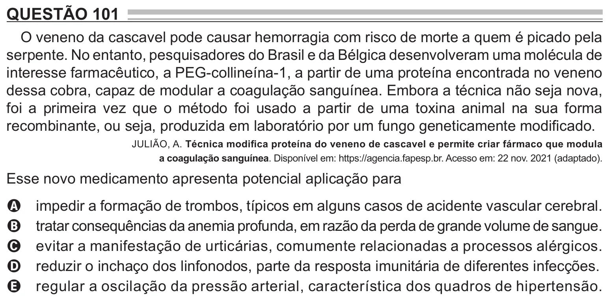

Texto extraído (pode conter ruído)

QUESTÃO 101  
O veneno da cascavel pode causar hemorragia com risco de morte a quem é picado pela  
serpente. No entanto, pesquisadores do Brasil e da Bélgica desenvolveram uma molécula de  
interesse farmacêutico, a PEG-collineína-1, a partir de uma proteína encontrada no veneno  
dessa cobra, capaz de modular a coagulação sanguínea. Embora a técnica não seja nova,  
foi a primeira vez que o método foi usado a partir de uma toxina animal na sua forma  
recombinante, ou seja, produzida em laboratório por um fungo geneticamente modificado.  
JULIÃO, A. Técnica modifica proteína do veneno de cascavel e permite criar fármaco que modula  
a coagulação sanguínea. Disponível em: https://agencia.fapesp.br. Acesso em: 22 nov. 2021 (adaptado).  
Esse novo medicamento apresenta potencial aplicação para  
impedir a formação de trombos, típicos em alguns casos de acidente vascular cerebral.  
A  
tratar consequências da anemia profunda, em razão da perda de grande volume de sangue.  
B  
evitar a manifestação de urticárias, comumente relacionadas a processos alérgicos.  
C  
reduzir o inchaço dos linfonodos, parte da resposta imunitária de diferentes infecções.  
D  
regular a oscilação da pressão arterial, característica dos quadros de hipertensão.  
E

