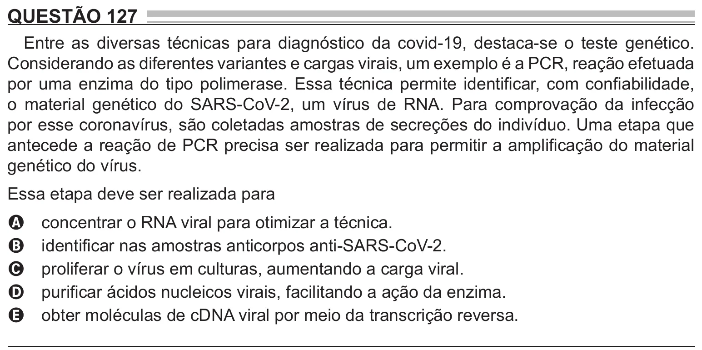

Texto extraído (pode conter ruído)

QUESTÃO 127  
Entre as diversas técnicas para diagnóstico da covid-19, destaca-se o teste genético.  
Considerando as diferentes variantes e cargas virais, um exemplo é a PCR, reação efetuada  
por uma enzima do tipo polimerase. Essa técnica permite identificar, com confiabilidade,  
o material genético do SARS-CoV-2, um vírus de RNA. Para comprovação da infecção  
por esse coronavírus, são coletadas amostras de secreções do indivíduo. Uma etapa que  
antecede a reação de PCR precisa ser realizada para permitir a amplificação do material  
genético do vírus.  
Essa etapa deve ser realizada para  
concentrar o RNA viral para otimizar a técnica.  
A  
identificar nas amostras anticorpos anti-SARS-CoV-2.  
B  
proliferar o vírus em culturas, aumentando a carga viral.  
C  
purificar ácidos nucleicos virais, facilitando a ação da enzima.  
D  
obter moléculas de cDNA viral por meio da transcrição reversa.  
E

