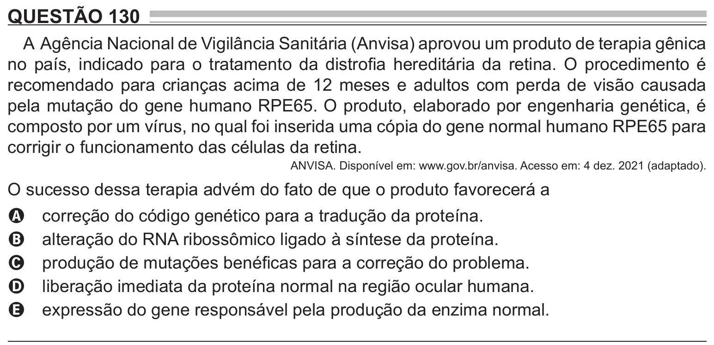

Texto extraído (pode conter ruído)

QUESTÃO 130  
A Agência Nacional de Vigilância Sanitária (Anvisa) aprovou um produto de terapia gênica  
no país, indicado para o tratamento da distrofia hereditária da retina. O procedimento é  
recomendado para crianças acima de 12 meses e adultos com perda de visão causada  
pela mutação do gene humano RPE65. O produto, elaborado por engenharia genética, é  
composto por um vírus, no qual foi inserida uma cópia do gene normal humano RPE65 para  
corrigir o funcionamento das células da retina.  
ANVISA. Disponível em: www.gov.br/anvisa. Acesso em: 4 dez. 2021 (adaptado).  
O sucesso dessa terapia advém do fato de que o produto favorecerá a  
correção do código genético para a tradução da proteína.  
A  
alteração do RNA ribossômico ligado à síntese da proteína.  
B  
produção de mutações benéficas para a correção do problema.  
C  
liberação imediata da proteína normal na região ocular humana.  
D  
expressão do gene responsável pela produção da enzima normal.  
E

