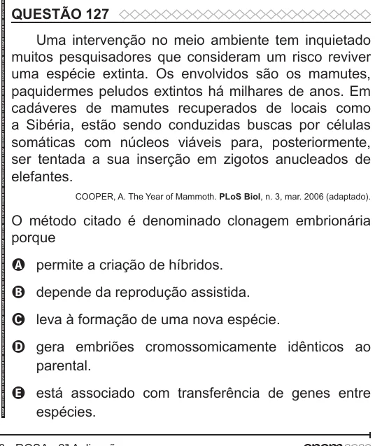

Texto extraído (pode conter ruído)

QUESTÃO 127  
Uma intervenção no meio ambiente tem inquietado  
muitos pesquisadores que consideram um risco reviver  
uma espécie extinta. Os envolvidos são os mamutes,  
paquidermes peludos extintos há milhares de anos. Em  
cadáveres de mamutes recuperados de locais como  
a Sibéria, estão sendo conduzidas buscas por células  
somáticas com núcleos viáveis para, posteriormente,  
ser tentada a sua inserção em zigotos anucleados de  
elefantes.  
COOPER, A. The Year of Mammoth. PLoS Biol, n. 3, mar. 2006 (adaptado).  
O método citado é denominado clonagem embrionária  
porque  
A permite a criação de híbridos.  
B depende da reprodução assistida.  
C leva à formação de uma nova espécie.  
D gera embriões cromossomicamente idênticos ao  
parental.  
E está associado com transferência de genes entre  
espécies.

