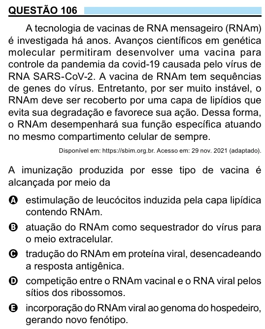

Texto extraído (pode conter ruído)

QUESTÃO 106  
A tecnologia de vacinas de RNA mensageiro (RNAm)  
é investigada há anos. Avanços científicos em genética  
molecular permitiram desenvolver uma vacina para  
controle da pandemia da covid-19 causada pelo vírus de  
RNA SARS-CoV-2. A vacina de RNAm tem sequências  
de genes do vírus. Entretanto, por ser muito instável, o  
RNAm deve ser recoberto por uma capa de lipídios que  
evita sua degradação e favorece sua ação. Dessa forma,  
o RNAm desempenhará sua função específica atuando  
no mesmo compartimento celular de sempre.  
Disponível em: https://sbim.org.br. Acesso em: 29 nov. 2021 (adaptado).  
A imunização produzida por esse tipo de vacina é  
alcançada por meio da  
A estimulação de leucócitos induzida pela capa lipídica  
contendo RNAm.  
B atuação do RNAm como sequestrador do vírus para  
o meio extracelular.  
C tradução do RNAm em proteína viral, desencadeando  
a resposta antigênica.  
D competição entre o RNAm vacinal e o RNA viral pelos  
sítios dos ribossomos.  
E incorporação do RNAm viral ao genoma do hospedeiro,  
gerando novo fenótipo.

