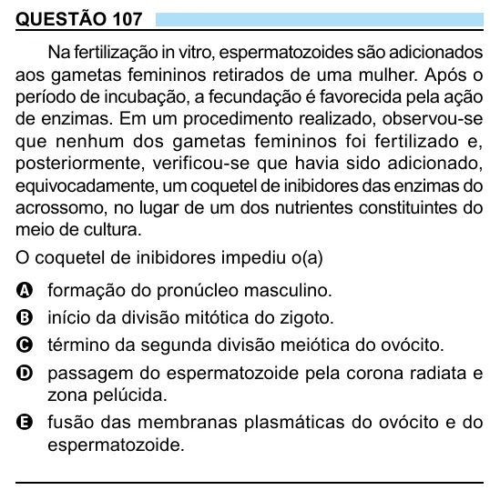

Texto extraído (pode conter ruído)

QUESTÃO 107  
Na fertilização in vitro, espermatozoides são adicionados  
aos gametas femininos retirados de uma mulher. Após o  
período de incubação, a fecundação é favorecida pela ação  
de enzimas. Em um procedimento realizado, observou-se  
que nenhum dos gametas femininos foi fertilizado e,  
posteriormente, verificou-se que havia sido adicionado,  
equivocadamente, um coquetel de inibidores das enzimas do  
acrossomo, no lugar de um dos nutrientes constituintes do  
meio de cultura.  
O coquetel de inibidores impediu o(a)  
A  
formação do pronúcleo masculino.  
início da divisão mitótica do zigoto.  
B  
término da segunda divisão meiótica do ovócito.  
C  
passagem do espermatozoide pela corona radiata e  
D  
zona pelúcida.  
E fusão das membranas plasmáticas do ovócito e do  
espermatozoide.

