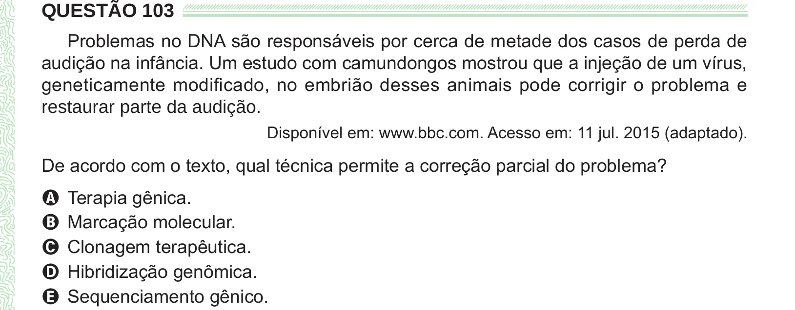

Texto extraído (pode conter ruído)

QUESTÃO 103  
Problemas no DNA são responsáveis por cerca de metade dos casos de perda de  
audição na infância. Um estudo com camundongos mostrou que a injeção de um vírus,  
geneticamente modificado, no embrião desses animais pode corrigir o problema e  
restaurar parte da audição.  
Disponível em: www.bbc.com. Acesso em: 11 jul. 2015 (adaptado).  
De acordo com o texto, qual técnica permite a correção parcial do problema?  
A Terapia gênica.  
B Marcação molecular.  
C Clonagem terapêutica.  
D Hibridização genômica.  
E Sequenciamento gênico.

