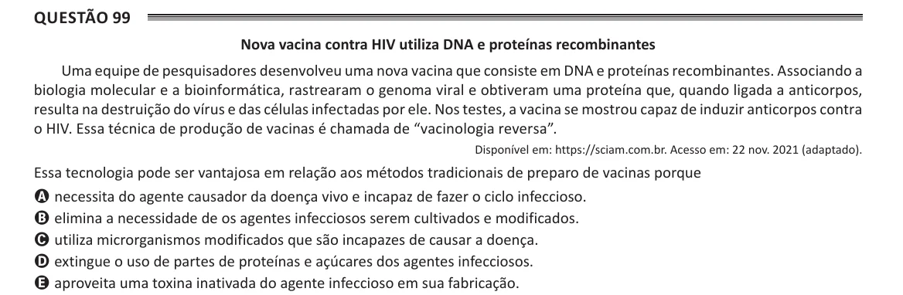

Texto extraído (pode conter ruído)

Questão 99  
Nova vacina contra HIV utiliza DNA e proteínas recombinantes  
Uma equipe de pesquisadores desenvolveu uma nova vacina que consiste em DNA e proteínas recombinantes. Associando a  
biologia molecular e a bioinformática, rastrearam o genoma viral e obtiveram uma proteína que, quando ligada a anticorpos,  
resulta na destruição do vírus e das células infectadas por ele. Nos testes, a vacina se mostrou capaz de induzir anticorpos contra  
o HIV. Essa técnica de produção de vacinas é chamada de “vacinologia reversa”.  
Disponível em: https://sciam.com.br. Acesso em: 22 nov. 2021 (adaptado).  
Essa tecnologia pode ser vantajosa em relação aos métodos tradicionais de preparo de vacinas porque  
A necessita do agente causador da doença vivo e incapaz de fazer o ciclo infeccioso.  
B elimina a necessidade de os agentes infecciosos serem cultivados e modificados.  
C utiliza microrganismos modificados que são incapazes de causar a doença.  
D extingue o uso de partes de proteínas e açúcares dos agentes infecciosos.  
E aproveita uma toxina inativada do agente infeccioso em sua fabricação.

