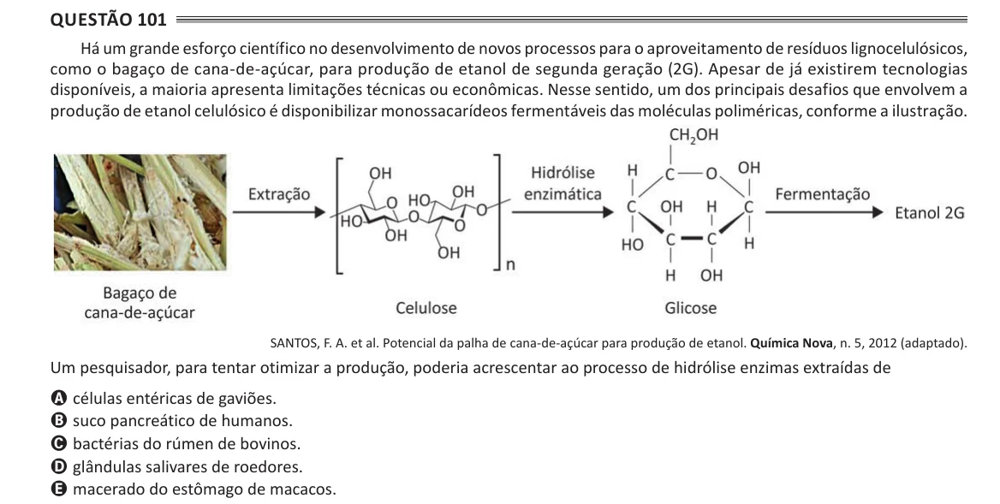

Texto extraído (pode conter ruído)

Questão 101  
Há um grande esforço científico no desenvolvimento de novos processos para o aproveitamento de resíduos lignocelulósicos,  
como o bagaço de cana-de-açúcar, para produção de etanol de segunda geração (2G). Apesar de já existirem tecnologias  
disponíveis, a maioria apresenta limitações técnicas ou econômicas. Nesse sentido, um dos principais desafios que envolvem a  
produção de etanol celulósico é disponibilizar monossacarídeos fermentáveis das moléculas poliméricas, conforme a ilustração.  
SANTOS, F. A. et al. Potencial da palha de cana-de-açúcar para produção de etanol. Química Nova, n. 5, 2012 (adaptado).  
Um pesquisador, para tentar otimizar a produção, poderia acrescentar ao processo de hidrólise enzimas extraídas de  
A células entéricas de gaviões.  
B suco pancreático de humanos.  
C bactérias do rúmen de bovinos.  
D glândulas salivares de roedores.  
E macerado do estômago de macacos.

