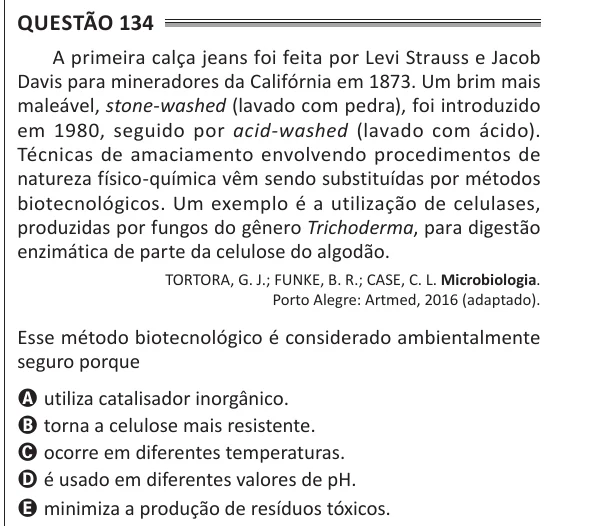

Texto extraído (pode conter ruído)

Questão 134  
A primeira calça jeans foi feita por Levi Strauss e Jacob  
Davis para mineradores da Califórnia em 1873. Um brim mais  
maleável, stone-washed (lavado com pedra), foi introduzido  
em 1980, seguido por acid-washed (lavado com ácido).  
Técnicas de amaciamento envolvendo procedimentos de  
natureza físico-química vêm sendo substituídas por métodos  
biotecnológicos. Um exemplo é a utilização de celulases,  
produzidas por fungos do gênero Trichoderma, para digestão  
enzimática de parte da celulose do algodão.  
TORTORA, G. J.; FUNKE, B. R.; CASE, C. L. Microbiologia.  
Porto Alegre: Artmed, 2016 (adaptado).  
Esse método biotecnológico é considerado ambientalmente  
seguro porque  
A utiliza catalisador inorgânico.  
B torna a celulose mais resistente.  
C ocorre em diferentes temperaturas.  
D é usado em diferentes valores de pH.  
E minimiza a produção de resíduos tóxicos.

