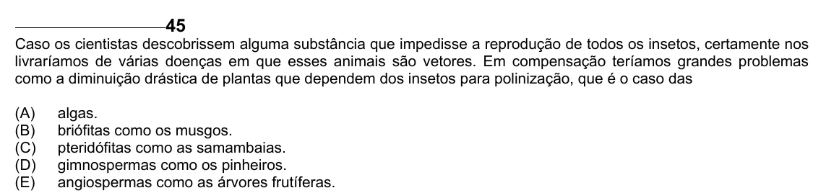

Texto extraído (pode conter ruído)

45  
Caso os cientistas descobrissem alguma substância que impedisse a reprodução de todos os insetos, certamente nos  
livraríamos de várias doenças em que esses animais são vetores. Em compensação teríamos grandes problemas  
como a diminuição drástica de plantas que dependem dos insetos para polinização, que é o caso das  
(A)  
algas.  
(B)  
briófitas como os musgos.  
(C)  
pteridófitas como as samambaias.  
(D)  
gimnospermas como os pinheiros.  
(E)  
angiospermas como as árvores frutíferas.

