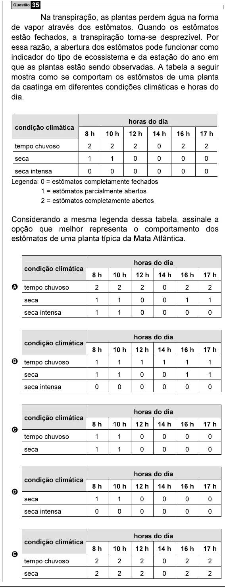

Texto extraído (pode conter ruído)

Questão 35  
Na transpiração, as plantas perdem água na forma  
de vapor através dos estômatos. Quando os estômatos  
estão fechados, a transpiração torna-se desprezível. Por  
essa razão, a abertura dos estômatos pode funcionar como  
indicador do tipo de ecossistema e da estação do ano em  
que as plantas estão sendo observadas. A tabela a seguir  
mostra como se comportam os estômatos de uma planta  
da caatinga em diferentes condições climáticas e horas do  
dia.  
horas do dia  
condição climática  
8 h  
10 h  
12 h  
14 h  
16 h  
17 h  
tempo chuvoso  
2  
2  
2  
0  
2  
2  
seca  
1  
1  
0  
0  
0  
0  
seca intensa  
0  
0  
0  
0  
0  
0  
Legenda: 0 = estômatos completamente fechados  
1 = estômatos parcialmente abertos  
2 = estômatos completamente abertos  
Considerando a mesma legenda dessa tabela, assinale a  
opção que melhor representa o comportamento dos  
estômatos de uma planta típica da Mata Atlântica.  
horas do dia  
condição climática  
8 h  
10 h  
12 h  
14 h  
16 h  
17 h  
A tempo chuvoso  
2  
2  
2  
0  
2  
2  
seca  
1  
1  
0  
0  
1  
1  
seca intensa  
1  
1  
0  
0  
0  
0  
horas do dia  
condição climática  
8 h  
10 h  
12 h  
14 h  
16 h  
17 h  
B tempo chuvoso  
1  
1  
1  
1  
1  
1  
seca  
1  
1  
0  
0  
1  
1  
seca intensa  
0  
0  
0  
0  
0  
0  
horas do dia  
condição climática  
8 h  
10 h  
12 h  
14 h  
16 h  
17 h  
C  
tempo chuvoso  
1  
1  
0  
0  
0  
0  
seca  
1  
1  
0  
0  
0  
0  
horas do dia  
condição climática  
8 h  
10 h  
12 h  
14 h  
16 h  
17 h  
D  
seca  
1  
1  
0  
0  
0  
0  
seca intensa  
0  
0  
0  
0  
0  
0  
horas do dia  
condição climática  
8 h  
10 h  
12 h  
14 h  
16 h  
17 h  
E  
tempo chuvoso  
2  
2  
2  
0  
2  
2  
seca  
2  
2  
2  
0  
2  
2

