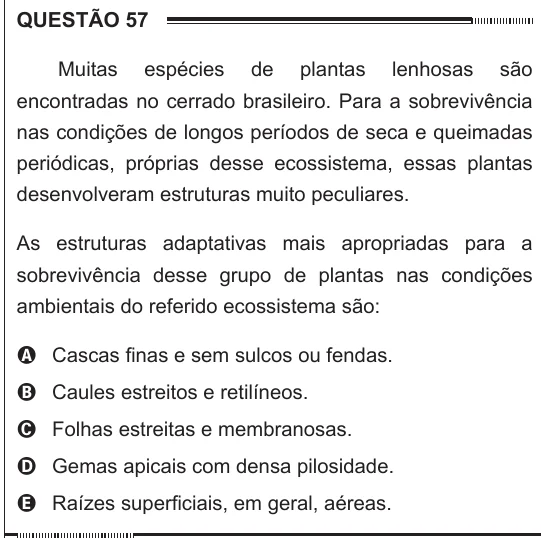

Texto extraído (pode conter ruído)

QUESTÃO 57  
Muitas  
espécies  
de  
plantas  
lenhosas  
são  
encontradas no cerrado brasileiro. Para a sobrevivência  
nas condições de longos períodos de seca e queimadas  
periódicas, próprias desse ecossistema, essas plantas  
desenvolveram estruturas muito peculiares.  
As estruturas adaptativas mais apropriadas para a  
sobrevivência desse grupo de plantas nas condições  
ambientais do referido ecossistema são:  
A Cascas finas e sem sulcos ou fendas.  
B Caules estreitos e retilíneos.  
C Folhas estreitas e membranosas.  
D Gemas apicais com densa pilosidade.  
E Raízes superficiais, em geral, aéreas.

