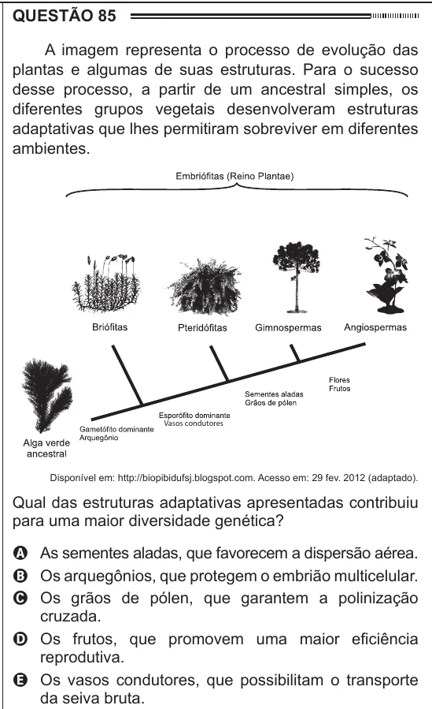

Texto extraído (pode conter ruído)

QUESTÃO 85  
A imagem representa o processo de evolução das  
plantas e algumas de suas estruturas. Para o sucesso  
desse processo, a partir de um ancestral simples, os  
diferentes grupos vegetais desenvolveram estruturas  
adaptativas que lhes permitiram sobreviver em diferentes  
ambientes.  
Vasos condutores  
Disponível em: http://biopibidufsj.blogspot.com. Acesso em: 29 fev. 2012 (adaptado).  
Qual das estruturas adaptativas apresentadas contribuiu  
para uma maior diversidade genética?  
A As sementes aladas, que favorecem a dispersão aérea.  
B Os arquegônios, que protegem o embrião multicelular.  
C Os grãos de pólen, que garantem a polinização  
cruzada.  
D Os frutos, que promovem uma maior eficiência  
reprodutiva.  
E Os vasos condutores, que possibilitam o transporte  
da seiva bruta.

