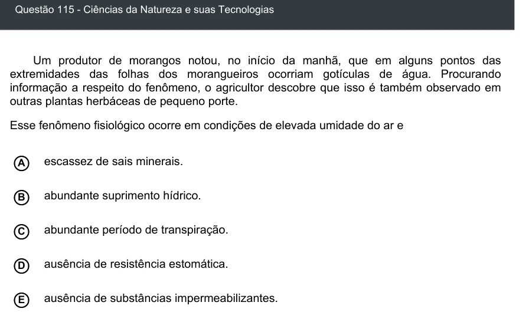

Texto extraído (pode conter ruído)

Questão 115 - Ciências da Natureza e suas Tecnologias  
Um produtor de morangos notou, no início da manhã, que em alguns pontos das  
extremidades das folhas dos morangueiros ocorriam gotículas de água. Procurando  
informação a respeito do fenômeno, o agricultor descobre que isso é também observado em  
outras plantas herbáceas de pequeno porte.  
Esse fenômeno fisiológico ocorre em condições de elevada umidade do ar e  
escassez de sais minerais.  
A  
abundante suprimento hídrico.  
B  
C  
abundante período de transpiração.  
ausência de resistência estomática.  
D  
ausência de substâncias impermeabilizantes.  
E

