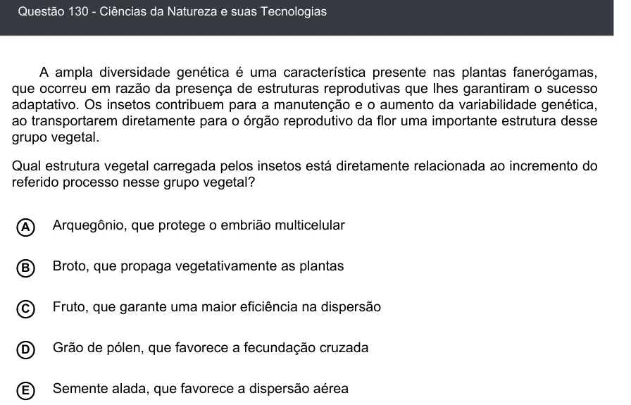

Texto extraído (pode conter ruído)

Questão 130 - Ciências da Natureza e suas Tecnologias  
A ampla diversidade genética é uma característica presente nas plantas fanerógamas,  
que ocorreu em razão da presença de estruturas reprodutivas que lhes garantiram o sucesso  
adaptativo. Os insetos contribuem para a manutenção e o aumento da variabilidade genética,  
ao transportarem diretamente para o órgão reprodutivo da flor uma importante estrutura desse  
grupo vegetal.  
Qual estrutura vegetal carregada pelos insetos está diretamente relacionada ao incremento do  
referido processo nesse grupo vegetal?  
Arquegônio, que protege o embrião multicelular  
A  
B  
Broto, que propaga vegetativamente as plantas  
Fruto, que garante uma maior eficiência na dispersão  
C  
Grão de pólen, que favorece a fecundação cruzada  
D  
E  
Semente alada, que favorece a dispersão aérea

