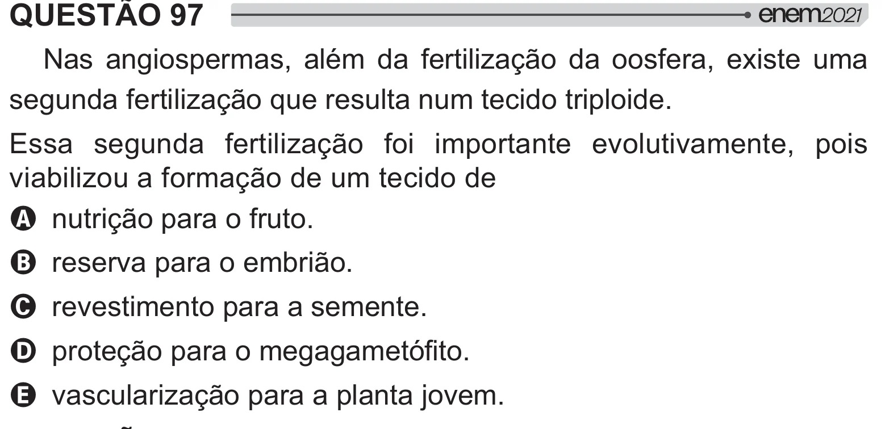

Texto extraído (pode conter ruído)

QUESTÃO 97  
Nas angiospermas, além da fertilização da oosfera, existe uma  
segunda fertilização que resulta num tecido triploide.  
Essa segunda fertilização foi importante evolutivamente, pois  
viabilizou a formação de um tecido de  
A nutrição para o fruto.  
B reserva para o embrião.  
C revestimento para a semente.  
D # =[#  ƒ !  
E vascularização para a planta jovem.

