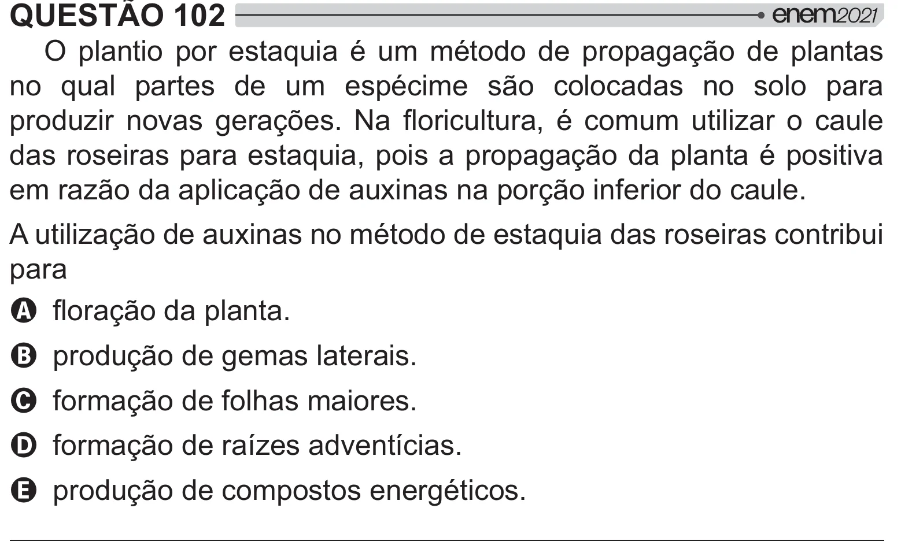

Texto extraído (pode conter ruído)

QUESTÃO 102  
O plantio por estaquia é um método de propagação de plantas  
no qual partes de um espécime são colocadas no solo para  
#  "   = ! ˆ }   <         
das roseiras para estaquia, pois a propagação da planta é positiva  
em razão da aplicação de auxinas na porção inferior do caule.  
A utilização de auxinas no método de estaquia das roseiras contribui  
para  
A }=[# !  
B produção de gemas laterais.  
C formação de folhas maiores.  
D formação de raízes adventícias.  
E produção de compostos energéticos.

