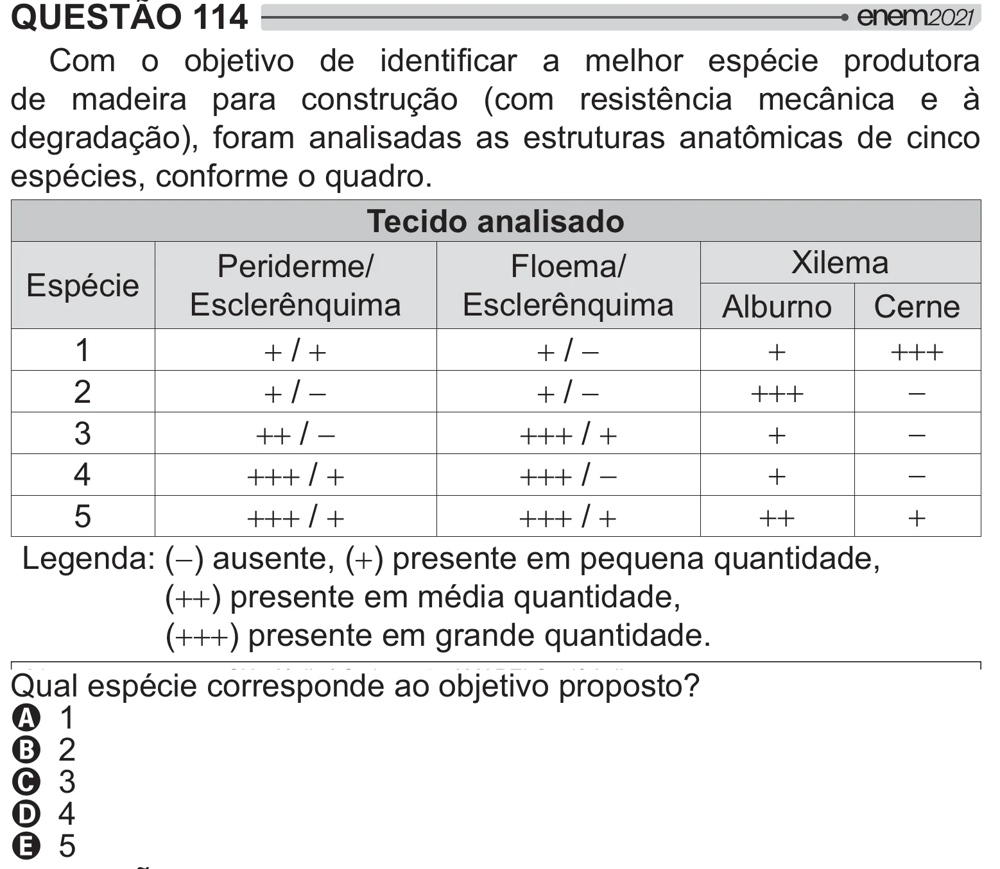

Texto extraído (pode conter ruído)

QUESTÃO 114  
  y‡ "        $  
#<  #   
de madeira para construção (com resistência mecânica e à  
 =[W >          2      
espécies, conforme o quadro.  
Tecido analisado  
Xilema  
Periderme/  
Floema/  
Espécie  
Esclerênquima  
Esclerênquima Alburno Cerne  
 /   
 /   
  
  
1  
 /   
 /   
  
  
2  
 /   
 /   
  
  
3  
 /   
 /   
  
  
4  
 /   
 /   
  
  
5  
Legenda: () ausente, () presente em pequena quantidade,  
() presente em média quantidade,  
() presente em grande quantidade.  
&   
#<   
# y‡ "## ]  
A 1  
B 2  
C 3  
D 4  
E 5

